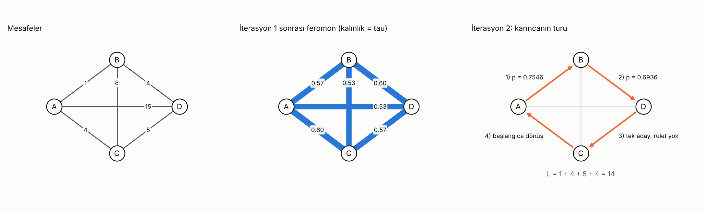
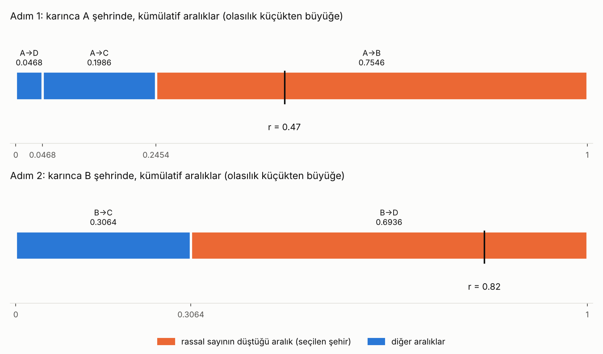
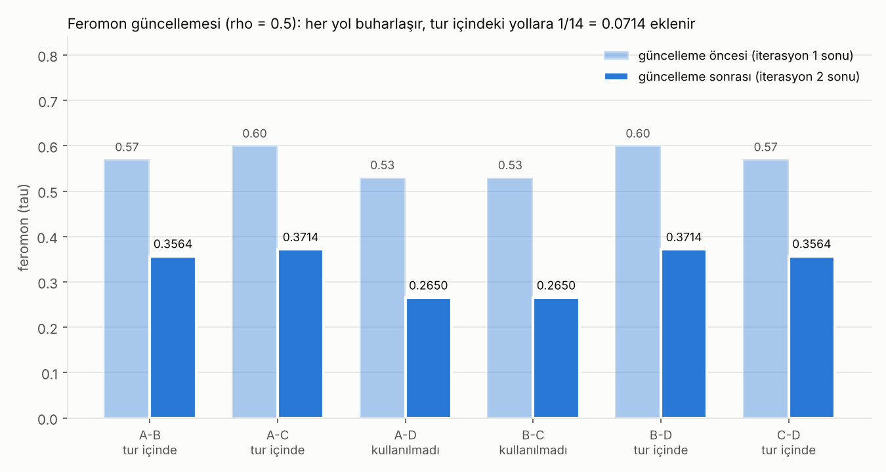

# 4 şehirli ACO örneği

Bu dosya, 4 şehirli (A, B, C, D) bir karınca kolonisi örneğini
`aco_dort_sehir.py` ile adım adım tekrarlar. Aşağıdaki çıktının hepsi kodun
çalıştırılmasıyla üretilmiştir.

## Problem

| Yol | Mesafe |
|---|---|
| A-B | 1 |
| A-C | 4 |
| A-D | 15 |
| B-C | 8 |
| B-D | 4 |
| C-D | 5 |

Parametreler: α = 1, β = 1, ρ = 0.5, başlangıç feromonu τ = 1 (her yolda).

## Formüller

| Ne | Formül |
|---|---|
| Görünürlük | η = 1 / d |
| Geçiş olasılığı | p = (τ^α · η^β) / Σ (τ^α · η^β), toplam yalnızca gidilmemiş şehirler üzerinden |
| Bir karıncanın bıraktığı | Δτ = 1 / L (karınca o yolu kullandıysa, yoksa 0) |
| Feromon güncelleme | τ(yeni) = (1 − ρ) · τ + Σ Δτ (buharlaşma tüm yollara uygulanır) |

α = β = 1 olduğunda τ · η = τ / d olur.

## Rulet çarkı seçimi

1. Olasılıklar küçükten büyüğe sıralanıp kümülatif toplanarak aralıklara çevrilir.
2. 0 ile 1 arasında rassal bir sayı üretilir.
3. Sayı hangi aralığa düşerse karınca o şehre gider.

Aralıkların sırası sonucu etkiler: aynı rassal sayı farklı sıralamada başka şehre denk
gelebilir. Bu örnekte olasılık küçükten büyüğe sıralanmıştır.

## Kod çıktısı

```text
================================================================
KARINCA KOLONİSİ - 4 ŞEHİRLİ EL HESABI
================================================================
alpha = 1, beta = 1, rho = 0.5, başlangıç tau = 1
Mesafeler: A-B=1, A-C=4, A-D=15, B-C=8, B-D=4, C-D=5

----------------------------------------------------------------
İTERASYON 1: iki karıncanın turu (verilen)
----------------------------------------------------------------
1. karınca: A → B → D → C → A   L = 14   → kullandığı yollara 1/14 = 0.0714
2. karınca: A → D → B → C → A   L = 31   → kullandığı yollara 1/31 = 0.0323

  Yol    eski tau   buharlaşma   delta_tau   yeni tau
  A-B    1.0000     0.5000       0.0714      0.5700
  A-C    1.0000     0.5000       0.1037      0.6000
  A-D    1.0000     0.5000       0.0323      0.5300
  B-C    1.0000     0.5000       0.0323      0.5300
  B-D    1.0000     0.5000       0.1037      0.6000
  C-D    1.0000     0.5000       0.0714      0.5700

  (tau değerleri 2 basamağa yuvarlandı)

----------------------------------------------------------------
İTERASYON 2: karınca A'dan çıkar
----------------------------------------------------------------

Adım 1: karınca A şehrinde, aday şehirler: B, C, D
  Yol    tau      eta=1/d  tau^a*eta^b  Olasılık
  A-B    0.5700   1.0000   0.57000      0.7546
  A-C    0.6000   0.2500   0.15000      0.1986
  A-D    0.5300   0.0667   0.03533      0.0468
  Payda = 0.75533
  Kümülatif aralıklar (olasılık küçükten büyüğe):
    A→D: 0.0000 - 0.0468
    A→C: 0.0468 - 0.2454
    A→B: 0.2454 - 1.0000
  Rassal sayı r = 0.47 → karınca B şehrine gider

Adım 2: karınca B şehrinde, aday şehirler: C, D
  Yol    tau      eta=1/d  tau^a*eta^b  Olasılık
  B-C    0.5300   0.1250   0.06625      0.3064
  B-D    0.6000   0.2500   0.15000      0.6936
  Payda = 0.21625
  Kümülatif aralıklar (olasılık küçükten büyüğe):
    B→C: 0.0000 - 0.3064
    B→D: 0.3064 - 1.0000
  Rassal sayı r = 0.82 → karınca D şehrine gider

Adım 3: karınca D şehrinde, aday şehirler: C
  Yol    tau      eta=1/d  tau^a*eta^b  Olasılık
  C-D    0.5700   0.2000   0.11400      1.0000
  Payda = 0.11400
  Tek aday kaldı → olasılık 1, rulet atılmaz → C

Tur: A → B → D → C → A   L = 14
Bu karıncanın bıraktığı: 1/14 = 0.0714 (kullandığı yollara)

  Yol    eski tau   buharlaşma   delta_tau   yeni tau
  A-B    0.5700     0.2850       0.0714      0.3564
  A-C    0.6000     0.3000       0.0714      0.3714
  A-D    0.5300     0.2650       0.0000      0.2650
  B-C    0.5300     0.2650       0.0000      0.2650
  B-D    0.6000     0.3000       0.0714      0.3714
  C-D    0.5700     0.2850       0.0714      0.3564
```

## Görseller

Görsellerdeki sayılar `aco_dort_sehir.py` fonksiyonlarından gelir. Yeniden üretmek için
`python gorseller_dort_sehir.py` çalıştırılır.

**Graf:** mesafeler, iterasyon 1 sonrası feromon (kalınlık tau ile orantılı) ve
iterasyon 2'deki karıncanın turu.



**Rulet çubukları:** her adımda kümülatif aralıklar ve rassal sayının düştüğü aralık.



**Feromon değişimi:** tur sonrası her yolun feromonu. Tüm yollar buharlaşır, tur içindeki yollara 1/L eklenir.



## Notlar

- İterasyon 1'deki tau değerleri 2 basamağa yuvarlanmıştır (0.57, 0.60,
  0.53). Yuvarlamasız hesap için `python aco_dort_sehir.py --tam` çalıştırılır; bu
  durumda olasılıklar son basamaklarda biraz değişir.
- Rassal sayılar (r1 = 0.47, r2 = 0.82) elle verilmiştir. Kendi sayılarını denemek için
  `--r 0.30 0.90` gibi kullanılır.
- Karınca D'ye geldiğinde gidilmemiş tek şehir C kaldığı için olasılık 1'dir ve rulet atılmaz.
- Gerçek ACO (rastgele sayılarla, çok karınca ve iterasyon) için
  `python aco_dort_sehir.py --mod calistir --karinca 5 --iterasyon 30` çalıştırılır.
  4 şehirde kaba kuvvet de yapıldığı için bulunan tur gerçek optimumla karşılaştırılır.
