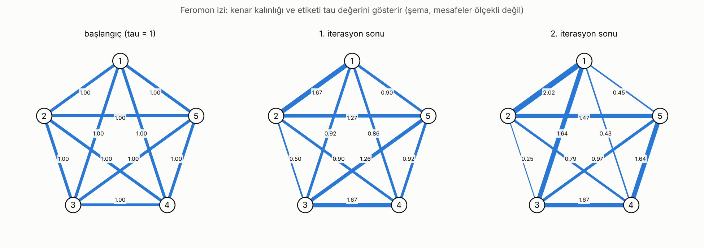
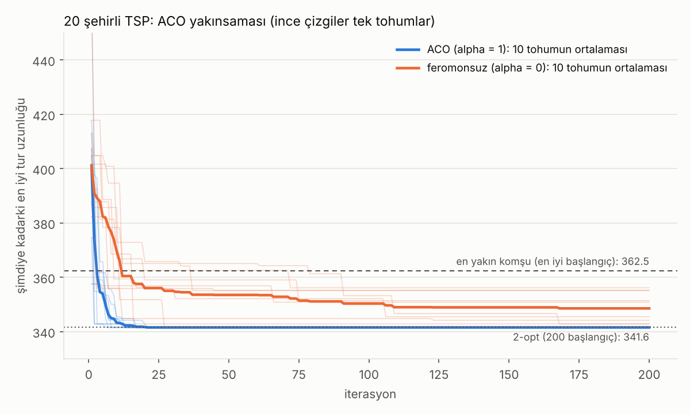
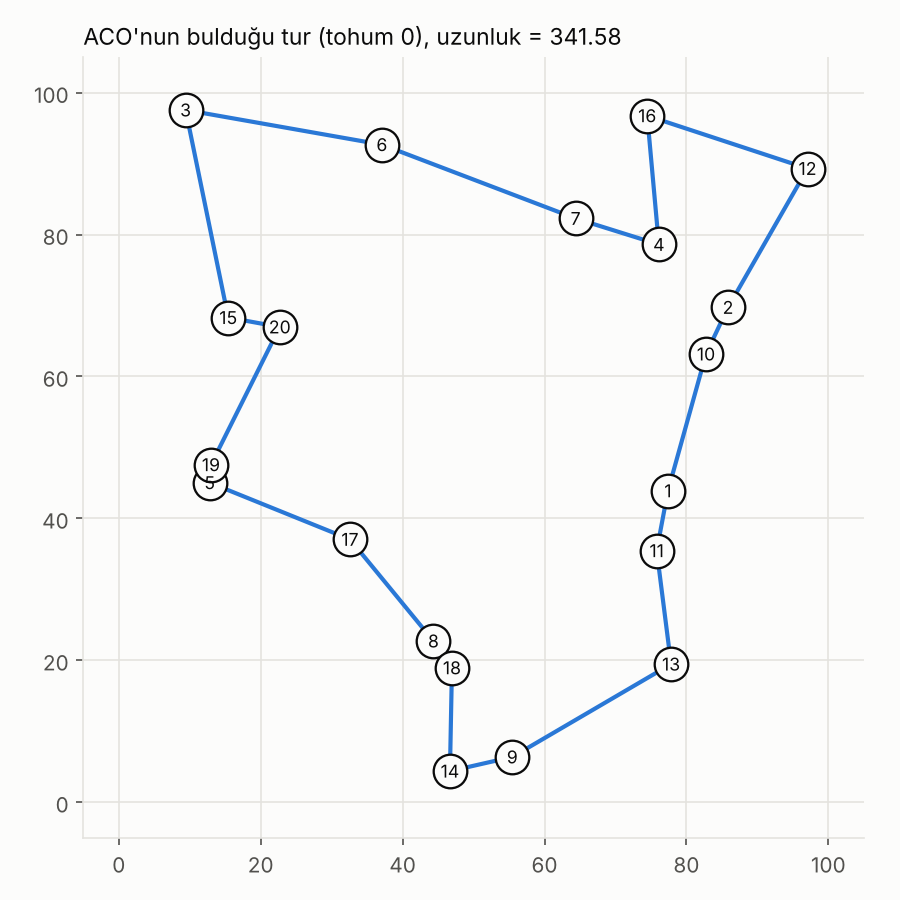

# Karınca Kolonisi Optimizasyonu (ACO)

Karınca Kolonisi Optimizasyonu'nu (Ant System) önce **elle** (5 şehirli küçük bir Gezgin Satıcı Problemi, 3 karınca, 2 iterasyon), sonra **kodla** çözdüm. Bu repo, el hesabının adım adım anlatımını ve aynı hesabı birebir tekrar eden Python kodunu içerir. Ayrıca genel amaçlı bir ACO (`aco.py`) ve 20 şehirli bir test var.

## Dosyalar

| Dosya | Açıklama |
|---|---|
| `aco_el_hesabi.py` | 5 şehirli TSP. El hesabını adım adım tekrar eder |
| `aco.py` | Genel ACO (NumPy): Ant System ve MMAS varyantı, referans yöntemler (rastgele tur, en yakın komşu, 2-opt) |
| `karsilastirma_mmas.py` | Ant System ile MMAS karşılaştırması (5 ve 20 şehir) |
| `gorseller_uret.py` | README'deki görselleri üretir |
| `gorseller/` | Üretilen görseller (PNG) |
| `requirements.txt` | Gereken paketler (`numpy`, `matplotlib`) |

## Neden feromon ve görünürlük?

- **Feromon (tau):** Kolonin ortak belleği. Kısa tur bulan karınca kullandığı kenarlara daha çok feromon bırakır, sonraki karıncalar o kenarlara daha çok yönelir.
- **Görünürlük (eta = 1/d):** Karıncanın yakın şehre gitme eğilimi. Başlangıçta tüm kenarlarda feromon eşit olduğu için ilk turlarda yönü bu belirler.
- **Buharlaşma (rho):** Eski izleri siler. Buharlaşma olmasaydı ilk bulunan tur (iyi ya da kötü) sonsuza kadar pekişirdi.
- İkisi `alpha` ve `beta` ağırlıklarıyla dengelenir: alpha büyükse karıncalar feromon izini, beta büyükse yakın şehri daha çok izler.

## Problem

5 şehir var. Her şehre tam bir kez uğrayıp başlangıç şehrine dönen **en kısa turu** bul. Şehirler arası mesafeler simetrik (`d(i,j) = d(j,i)`):

| d | 1 | 2 | 3 | 4 | 5 |
|---|---|---|---|---|---|
| **1** | – | 3 | 8 | 9 | 5 |
| **2** | 3 | – | 4 | 7 | 6 |
| **3** | 8 | 4 | – | 3 | 7 |
| **4** | 9 | 7 | 3 | – | 4 |
| **5** | 5 | 6 | 7 | 4 | – |

Tüm turlar denenerek bulunan gerçek optimum: **1 -> 2 -> 3 -> 4 -> 5 -> 1**, `L = 19`. ACO'nun yaklaşması gereken değer budur.

| Parametre | Değer |
|---|---|
| Karınca sayısı | 3 (başlangıç şehirleri: 1, 3, 5) |
| `alpha` (feromon ağırlığı) | 1 |
| `beta` (görünürlük ağırlığı) | 2 |
| `rho` (buharlaşma) | 0.5 |
| `Q` (feromon miktarı) | 10 |
| Başlangıç feromonu `tau0` | 1 (tüm kenarlarda) |
| Görünürlük | `eta(i,j) = 1 / d(i,j)` |
| Rassal sayılar (rulet için) | elle verildi, aşağıdaki tablolarda `r` sütununda |

Formüller:

```
p(i,j) = [tau(i,j)^alpha * eta(i,j)^beta] / toplam_l [tau(i,l)^alpha * eta(i,l)^beta]     (l: gidilmemiş şehirler)

tau(i,j) = (1 - rho) * tau(i,j) + toplam_k delta_k(i,j)
delta_k(i,j) = Q / L_k      (k. karıncanın turu (i,j) kenarını kullandıysa, değilse 0)
```

**Rulet seçimi:** Adayların olasılıkları sırayla toplanır (kümülatif). Rassal sayı `r` ile karşılaştırılır ve kümülatif değeri ilk kez `r`'ye eşit veya büyük olan aday seçilir. Örneğin olasılıklar 0.62 / 0.09 / 0.07 / 0.22 ise kümülatif değerler 0.62 / 0.71 / 0.78 / 1.00 olur, `r = 0.40` ilk adayı, `r = 0.75` üçüncüyü seçtirir.

Her iterasyonun sırası: **tüm karıncalar turunu kurar → buharlaşma → her karıncanın feromonu eklenir.** Feromon iterasyonun sonunda güncellenir, tur kurulurken tau sabittir.

## El hesabı

> Sayılar ekranda 4 ondalığa **yuvarlanarak** gösterilir, hesap tam hassasiyetle yapılır. Ara sonuçları kendin yuvarlarsan son hanelerde küçük farklar çıkabilir.

### 0. iterasyon (başlangıç)

Henüz tur kurulmadı. Tüm kenarlarda `tau = 1`. Görünürlük `eta = 1/d`:

| eta | 1 | 2 | 3 | 4 | 5 |
|---|---|---|---|---|---|
| **1** | – | 0.3333 | 0.1250 | 0.1111 | 0.2000 |
| **2** | 0.3333 | – | 0.2500 | 0.1429 | 0.1667 |
| **3** | 0.1250 | 0.2500 | – | 0.3333 | 0.1429 |
| **4** | 0.1111 | 0.1429 | 0.3333 | – | 0.2500 |
| **5** | 0.2000 | 0.1667 | 0.1429 | 0.2500 | – |

Başlangıçta tau eşit olduğu için seçimi yalnızca görünürlük (yani mesafe) belirler: yakın şehir daha olası.

### 1. iterasyon

Tur kurulurken `tau` sabittir. Karıncaların seçimleri `tau^1 · eta^2` ağırlıklarına göre yapılır. 1. karıncanın tüm adımları ayrıntılı, 2. ve 3. karıncanınki özet tabloyla gösteriliyor.

#### Karınca 1 (şehir 1'den başlıyor)

**Adım 1:** şehir 1'deyiz, aday şehirler: 2, 3, 4, 5

| aday | tau | eta | tau · eta² | p | kümülatif |
|---|---|---|---|---|---|
| 2 | 1.0000 | 0.3333 | 0.111111 | 0.6204 | 0.6204 |
| 3 | 1.0000 | 0.1250 | 0.015625 | 0.0873 | 0.7077 |
| 4 | 1.0000 | 0.1111 | 0.012346 | 0.0689 | 0.7766 |
| 5 | 1.0000 | 0.2000 | 0.040000 | 0.2234 | 1.0000 |

Örnek hesap: p(1,2) = 0.111111 / (0.111111 + 0.015625 + 0.012346 + 0.040000) = 0.111111 / 0.179082 = 0.6204

`r = 0.40` → kümülatif değeri ilk kez ≥ r olan aday: **şehir 2**.

**Adım 2:** şehir 2'deyiz, aday şehirler: 3, 4, 5

| aday | tau | eta | tau · eta² | p | kümülatif |
|---|---|---|---|---|---|
| 3 | 1.0000 | 0.2500 | 0.062500 | 0.5647 | 0.5647 |
| 4 | 1.0000 | 0.1429 | 0.020408 | 0.1844 | 0.7490 |
| 5 | 1.0000 | 0.1667 | 0.027778 | 0.2510 | 1.0000 |

`r = 0.75` → kümülatif değeri ilk kez ≥ r olan aday: **şehir 5**.

**Adım 3:** şehir 5'deyiz, aday şehirler: 3, 4

| aday | tau | eta | tau · eta² | p | kümülatif |
|---|---|---|---|---|---|
| 3 | 1.0000 | 0.1429 | 0.020408 | 0.2462 | 0.2462 |
| 4 | 1.0000 | 0.2500 | 0.062500 | 0.7538 | 1.0000 |

`r = 0.30` → kümülatif değeri ilk kez ≥ r olan aday: **şehir 4**.

**Adım 4:** şehir 4'deyiz, aday şehirler: 3

| aday | tau | eta | tau · eta² | p | kümülatif |
|---|---|---|---|---|---|
| 3 | 1.0000 | 0.3333 | 0.111111 | 1.0000 | 1.0000 |

Tek aday kaldı, **şehir 3** zorunlu adım.

Tur: **1 -> 2 -> 5 -> 4 -> 3 -> 1**, uzunluk **L = 24**

#### Karınca 2 (şehir 3'ten başlıyor)

| Adım | Şehir | Adaylar → olasılık p | Kümülatif | r | Seçilen |
|---|---|---|---|---|---|
| 1 | 3 | 1: 0.0745, 2: 0.2981, 4: 0.5300, 5: 0.0973 | 0.0745 / 0.3727 / 0.9027 / 1.0000 | 0.85 | 4 |
| 2 | 4 | 1: 0.1296, 2: 0.2143, 5: 0.6561 | 0.1296 / 0.3439 / 1.0000 | 0.20 | 2 |
| 3 | 2 | 1: 0.8000, 5: 0.2000 | 0.8000 / 1.0000 | 0.60 | 1 |
| 4 | 1 | 5: 1.0000 | 1.0000 | – | 5 (zorunlu) |

Tur: **3 -> 4 -> 2 -> 1 -> 5 -> 3**, uzunluk **L = 25**

#### Karınca 3 (şehir 5'ten başlıyor)

| Adım | Şehir | Adaylar → olasılık p | Kümülatif | r | Seçilen |
|---|---|---|---|---|---|
| 1 | 5 | 1: 0.2655, 2: 0.1843, 3: 0.1354, 4: 0.4148 | 0.2655 / 0.4498 / 0.5852 / 1.0000 | 0.55 | 3 |
| 2 | 3 | 1: 0.0826, 2: 0.3303, 4: 0.5872 | 0.0826 / 0.4128 / 1.0000 | 0.90 | 4 |
| 3 | 4 | 1: 0.3769, 2: 0.6231 | 0.3769 / 1.0000 | 0.10 | 1 |
| 4 | 1 | 2: 1.0000 | 1.0000 | – | 2 (zorunlu) |

Tur: **5 -> 3 -> 4 -> 1 -> 2 -> 5**, uzunluk **L = 28**

#### Feromon güncelleme

Her karınca kullandığı kenarlara `Q / L` kadar feromon bırakır (Q = 10):

| Karınca | Tur | L | Q / L |
|---|---|---|---|
| 1 | 1 -> 2 -> 5 -> 4 -> 3 -> 1 | 24 | 0.4167 |
| 2 | 3 -> 4 -> 2 -> 1 -> 5 -> 3 | 25 | 0.4000 |
| 3 | 5 -> 3 -> 4 -> 1 -> 2 -> 5 | 28 | 0.3571 |

Önce **buharlaşma**, `(1 - rho) · tau`, rho = 0.5 olduğu için her kenar yarıya iner:

|  | 1 | 2 | 3 | 4 | 5 |
|---|---|---|---|---|---|
| **1** | – | 0.5000 | 0.5000 | 0.5000 | 0.5000 |
| **2** | 0.5000 | – | 0.5000 | 0.5000 | 0.5000 |
| **3** | 0.5000 | 0.5000 | – | 0.5000 | 0.5000 |
| **4** | 0.5000 | 0.5000 | 0.5000 | – | 0.5000 |
| **5** | 0.5000 | 0.5000 | 0.5000 | 0.5000 | – |

**Eklenen feromon** (`delta`): örnek olarak 1-2 kenarını karınca 1, karınca 2, karınca 3 kullandı: 0.4167 + 0.4000 + 0.3571 = 1.1738

|  | 1 | 2 | 3 | 4 | 5 |
|---|---|---|---|---|---|
| **1** | – | 1.1738 | 0.4167 | 0.3571 | 0.4000 |
| **2** | 1.1738 | – | 0.0000 | 0.4000 | 0.7738 |
| **3** | 0.4167 | 0.0000 | – | 1.1738 | 0.7571 |
| **4** | 0.3571 | 0.4000 | 1.1738 | – | 0.4167 |
| **5** | 0.4000 | 0.7738 | 0.7571 | 0.4167 | – |

**Yeni feromon** `tau = buharlaşmış + delta`, örnek: tau(1,2) = 0.5000 + 1.1738 = 1.6738

|  | 1 | 2 | 3 | 4 | 5 |
|---|---|---|---|---|---|
| **1** | – | 1.6738 | 0.9167 | 0.8571 | 0.9000 |
| **2** | 1.6738 | – | 0.5000 | 0.9000 | 1.2738 |
| **3** | 0.9167 | 0.5000 | – | 1.6738 | 1.2571 |
| **4** | 0.8571 | 0.9000 | 1.6738 | – | 0.9167 |
| **5** | 0.9000 | 1.2738 | 1.2571 | 0.9167 | – |

Bu iterasyonun en kısa turu L = 24. Şimdiye kadarki en iyi: **1 -> 2 -> 5 -> 4 -> 3 -> 1** (L = 24).

### 2. iterasyon

Artık `tau` eşit değil. Karıncalar hem mesafeye hem 1. iterasyonda bırakılan feromona bakıyor. Örnek: 1. karıncanın ilk adımında 1-2 kenarının ağırlığı `1.6738 · 0.3333² = 0.185979`, 1. iterasyondaki `0.111111`'den belirgin şekilde büyük.

#### Karınca 1 (şehir 1'den başlıyor)

| Adım | Şehir | Adaylar → olasılık p | Kümülatif | r | Seçilen |
|---|---|---|---|---|---|
| 1 | 1 | 2: 0.7533, 3: 0.0580, 4: 0.0429, 5: 0.1458 | 0.7533 / 0.8113 / 0.8542 / 1.0000 | 0.15 | 2 |
| 2 | 2 | 3: 0.3676, 4: 0.2161, 5: 0.4163 | 0.3676 / 0.5837 / 1.0000 | 0.50 | 4 |
| 3 | 4 | 3: 0.7645, 5: 0.2355 | 0.7645 / 1.0000 | 0.80 | 5 |
| 4 | 5 | 3: 1.0000 | 1.0000 | – | 3 (zorunlu) |

Tur: **1 -> 2 -> 4 -> 5 -> 3 -> 1**, uzunluk **L = 29**

#### Karınca 2 (şehir 3'ten başlıyor)

| Adım | Şehir | Adaylar → olasılık p | Kümülatif | r | Seçilen |
|---|---|---|---|---|---|
| 1 | 3 | 1: 0.0557, 2: 0.1215, 4: 0.7231, 5: 0.0997 | 0.0557 / 0.1772 / 0.9003 / 1.0000 | 0.70 | 4 |
| 2 | 4 | 1: 0.1227, 2: 0.2130, 5: 0.6643 | 0.1227 / 0.3357 / 1.0000 | 0.35 | 5 |
| 3 | 5 | 1: 0.5043, 2: 0.4957 | 0.5043 / 1.0000 | 0.95 | 2 |
| 4 | 2 | 1: 1.0000 | 1.0000 | – | 1 (zorunlu) |

Tur: **3 -> 4 -> 5 -> 2 -> 1 -> 3**, uzunluk **L = 24**

#### Karınca 3 (şehir 5'ten başlıyor)

| Adım | Şehir | Adaylar → olasılık p | Kümülatif | r | Seçilen |
|---|---|---|---|---|---|
| 1 | 5 | 1: 0.2333, 2: 0.2293, 3: 0.1662, 4: 0.3712 | 0.2333 / 0.4625 / 0.6288 / 1.0000 | 0.25 | 2 |
| 2 | 2 | 1: 0.7894, 3: 0.1326, 4: 0.0780 | 0.7894 / 0.9220 / 1.0000 | 0.65 | 1 |
| 3 | 1 | 3: 0.5751, 4: 0.4249 | 0.5751 / 1.0000 | 0.45 | 3 |
| 4 | 3 | 4: 1.0000 | 1.0000 | – | 4 (zorunlu) |

Tur: **5 -> 2 -> 1 -> 3 -> 4 -> 5**, uzunluk **L = 24**

#### Feromon güncelleme

Her karınca kullandığı kenarlara `Q / L` kadar feromon bırakır (Q = 10):

| Karınca | Tur | L | Q / L |
|---|---|---|---|
| 1 | 1 -> 2 -> 4 -> 5 -> 3 -> 1 | 29 | 0.3448 |
| 2 | 3 -> 4 -> 5 -> 2 -> 1 -> 3 | 24 | 0.4167 |
| 3 | 5 -> 2 -> 1 -> 3 -> 4 -> 5 | 24 | 0.4167 |

Önce **buharlaşma**, `(1 - rho) · tau`, rho = 0.5 olduğu için her kenar yarıya iner:

|  | 1 | 2 | 3 | 4 | 5 |
|---|---|---|---|---|---|
| **1** | – | 0.8369 | 0.4583 | 0.4286 | 0.4500 |
| **2** | 0.8369 | – | 0.2500 | 0.4500 | 0.6369 |
| **3** | 0.4583 | 0.2500 | – | 0.8369 | 0.6286 |
| **4** | 0.4286 | 0.4500 | 0.8369 | – | 0.4583 |
| **5** | 0.4500 | 0.6369 | 0.6286 | 0.4583 | – |

**Eklenen feromon** (`delta`): örnek olarak 1-2 kenarını karınca 1, karınca 2, karınca 3 kullandı: 0.3448 + 0.4167 + 0.4167 = 1.1782

|  | 1 | 2 | 3 | 4 | 5 |
|---|---|---|---|---|---|
| **1** | – | 1.1782 | 1.1782 | 0.0000 | 0.0000 |
| **2** | 1.1782 | – | 0.0000 | 0.3448 | 0.8333 |
| **3** | 1.1782 | 0.0000 | – | 0.8333 | 0.3448 |
| **4** | 0.0000 | 0.3448 | 0.8333 | – | 1.1782 |
| **5** | 0.0000 | 0.8333 | 0.3448 | 1.1782 | – |

**Yeni feromon** `tau = buharlaşmış + delta`, örnek: tau(1,2) = 0.8369 + 1.1782 = 2.0151

|  | 1 | 2 | 3 | 4 | 5 |
|---|---|---|---|---|---|
| **1** | – | 2.0151 | 1.6365 | 0.4286 | 0.4500 |
| **2** | 2.0151 | – | 0.2500 | 0.7948 | 1.4702 |
| **3** | 1.6365 | 0.2500 | – | 1.6702 | 0.9734 |
| **4** | 0.4286 | 0.7948 | 1.6702 | – | 1.6365 |
| **5** | 0.4500 | 1.4702 | 0.9734 | 1.6365 | – |

Bu iterasyonun en kısa turu L = 24. Şimdiye kadarki en iyi: **1 -> 2 -> 5 -> 4 -> 3 -> 1** (L = 24).

### Gözlemler

- **Feromon, kısa turlarda kullanılan kenarlarda birikiyor.** 1. iterasyonda 1-2 ve 3-4 kenarlarını üç karınca da kullandı, bu iki kenarın feromonu 1'den 1.67'ye çıktı. İkisi de gerçek optimum turun (1 → 2 → 3 → 4 → 5 → 1) kenarı.
- **İki iterasyonda optimum bulunamadı.** Turlar 1. iterasyonda 24, 25, 28, 2. iterasyonda 29, 24, 24 uzunluğunda. En iyisi 24, optimum ise 19. İki iterasyon ve üç karıncayla bu beklenen bir durum.
- **Seçim olasılıksal, her zaman en olası aday seçilmiyor.** 1. iterasyonda 3. karınca ilk adımda olasılığı yalnızca 0.1354 olan 3. şehri seçti (`r = 0.55`) ve en uzun turu (L = 28) kurdu. Bu rassallık keşfi sağlıyor.
- **Hiç kullanılmayan kenarın feromonu sadece buharlaşıyor.** Optimum turun 2-3 kenarını hiçbir karınca kullanmadığı için feromonu 1'den 0.50'ye, sonra 0.25'e düştü. İyi bir kenarın bu şekilde unutulması, ACO'nun erken yakınsama riskinin kaynağı (aşağıdaki uzun çalıştırmada görülüyor).

### Feromonun değişimi



Kenar kalınlığı ve etiketi `tau` değerini gösterir. Şehirler şema olarak beşgene dizilmiştir, mesafeler ölçekli değildir. 1-2 ve 3-4 kenarları kalınlaşırken 2-3 kenarı incelir.

### Daha uzun çalıştırma

Aynı kurulum (3 karınca, aynı başlangıç şehirleri), 100 iterasyon, ilk iki iterasyonda yukarıdaki `r` değerleri, sonrasında rastgele `r`, 10 farklı tohum:

| Tohum | En iyi L | İlk bulunduğu iterasyon |
|---|---|---|
| 0 | 19 | 5 |
| 1 | 24 | 1 |
| 2 | 24 | 1 |
| 3 | 19 | 3 |
| 4 | 19 | 3 |
| 5 | 19 | 4 |
| 6 | 19 | 3 |
| 7 | 19 | 4 |
| 8 | 19 | 5 |
| 9 | 24 | 1 |

- **7/10 tohum optimuma (19) ulaştı**, hepsi ilk 5 iterasyon içinde.
- **Tohum 1, 2 ve 9'da 1. iterasyonda bulunan 24'lük tur hiç iyileşmedi.** Bu tohumlarda 100. iterasyonda feromonun tamamı o turun (1 → 2 → 5 → 4 → 3 → 1) 5 kenarında toplanmış, diğer kenarlarda ≈ 0 kalmıştı. Karıncalar artık yalnızca aynı turu tekrar ediyor. Optimuma ulaşan 7 tohumda da aynı yakınsama var, ama orada feromon optimum turun 5 kenarında toplanmış.
- **10 tohum küçük bir örneklem.** Aynı kurulumda 200 tohumla 183'ü (%91.5) optimuma ulaşıyor, yani takılma burada görünenden daha nadir (bkz. [Ant System ve MMAS karşılaştırması](#ant-system-ve-mmas-karşılaştırması)).
- Optimum tur farklı başlangıç şehri ve yönle yazılmış olabilir (ör. `3 -> 2 -> 1 -> 5 -> 4 -> 3` ile `1 -> 2 -> 3 -> 4 -> 5 -> 1` aynı turdur).

## Kodu çalıştırma

```bash
pip install -r requirements.txt
python aco_el_hesabi.py
```

<details>
<summary>Tam çıktı</summary>

```
==================================================================
A) EL HESABININ TEKRARI  (3 karınca, 2 iterasyon, alpha=1, beta=2, rho=0.5, Q=10)
==================================================================
Mesafe matrisi d:
             1        2        3        4        5
   1    0.0000   3.0000   8.0000   9.0000   5.0000
   2    3.0000   0.0000   4.0000   7.0000   6.0000
   3    8.0000   4.0000   0.0000   3.0000   7.0000
   4    9.0000   7.0000   3.0000   0.0000   4.0000
   5    5.0000   6.0000   7.0000   4.0000   0.0000

Görünürlük eta = 1/d:
             1        2        3        4        5
   1    0.0000   0.3333   0.1250   0.1111   0.2000
   2    0.3333   0.0000   0.2500   0.1429   0.1667
   3    0.1250   0.2500   0.0000   0.3333   0.1429
   4    0.1111   0.1429   0.3333   0.0000   0.2500
   5    0.2000   0.1667   0.1429   0.2500   0.0000

Başlangıç feromonu: tau0 = 1 (tüm kenarlarda)

--- 1. iterasyon ---
Başlangıçtaki feromon matrisi tau:
             1        2        3        4        5
   1    0.0000   1.0000   1.0000   1.0000   1.0000
   2    1.0000   0.0000   1.0000   1.0000   1.0000
   3    1.0000   1.0000   0.0000   1.0000   1.0000
   4    1.0000   1.0000   1.0000   0.0000   1.0000
   5    1.0000   1.0000   1.0000   1.0000   0.0000

Karınca 1 (başlangıç şehri 1)
  Adım 1: şehir 1'deyken, aday şehirler: 2, 3, 4, 5
    aday |     tau |     eta | tau^a*eta^b |       p |   küm.
       2 |  1.0000 |  0.3333 |    0.111111 |  0.6204 | 0.6204
       3 |  1.0000 |  0.1250 |    0.015625 |  0.0873 | 0.7077
       4 |  1.0000 |  0.1111 |    0.012346 |  0.0689 | 0.7766
       5 |  1.0000 |  0.2000 |    0.040000 |  0.2234 | 1.0000
    r = 0.40 -> seçilen şehir 2
  Adım 2: şehir 2'deyken, aday şehirler: 3, 4, 5
    aday |     tau |     eta | tau^a*eta^b |       p |   küm.
       3 |  1.0000 |  0.2500 |    0.062500 |  0.5647 | 0.5647
       4 |  1.0000 |  0.1429 |    0.020408 |  0.1844 | 0.7490
       5 |  1.0000 |  0.1667 |    0.027778 |  0.2510 | 1.0000
    r = 0.75 -> seçilen şehir 5
  Adım 3: şehir 5'deyken, aday şehirler: 3, 4
    aday |     tau |     eta | tau^a*eta^b |       p |   küm.
       3 |  1.0000 |  0.1429 |    0.020408 |  0.2462 | 0.2462
       4 |  1.0000 |  0.2500 |    0.062500 |  0.7538 | 1.0000
    r = 0.30 -> seçilen şehir 4
  Adım 4: şehir 4'deyken, aday şehirler: 3
    aday |     tau |     eta | tau^a*eta^b |       p |   küm.
       3 |  1.0000 |  0.3333 |    0.111111 |  1.0000 | 1.0000
    tek aday kaldı -> şehir 3 (zorunlu adım)
  Tur: 1 -> 2 -> 5 -> 4 -> 3 -> 1   uzunluk L = 24

Karınca 2 (başlangıç şehri 3)
  Adım 1: şehir 3'deyken, aday şehirler: 1, 2, 4, 5
    aday |     tau |     eta | tau^a*eta^b |       p |   küm.
       1 |  1.0000 |  0.1250 |    0.015625 |  0.0745 | 0.0745
       2 |  1.0000 |  0.2500 |    0.062500 |  0.2981 | 0.3727
       4 |  1.0000 |  0.3333 |    0.111111 |  0.5300 | 0.9027
       5 |  1.0000 |  0.1429 |    0.020408 |  0.0973 | 1.0000
    r = 0.85 -> seçilen şehir 4
  Adım 2: şehir 4'deyken, aday şehirler: 1, 2, 5
    aday |     tau |     eta | tau^a*eta^b |       p |   küm.
       1 |  1.0000 |  0.1111 |    0.012346 |  0.1296 | 0.1296
       2 |  1.0000 |  0.1429 |    0.020408 |  0.2143 | 0.3439
       5 |  1.0000 |  0.2500 |    0.062500 |  0.6561 | 1.0000
    r = 0.20 -> seçilen şehir 2
  Adım 3: şehir 2'deyken, aday şehirler: 1, 5
    aday |     tau |     eta | tau^a*eta^b |       p |   küm.
       1 |  1.0000 |  0.3333 |    0.111111 |  0.8000 | 0.8000
       5 |  1.0000 |  0.1667 |    0.027778 |  0.2000 | 1.0000
    r = 0.60 -> seçilen şehir 1
  Adım 4: şehir 1'deyken, aday şehirler: 5
    aday |     tau |     eta | tau^a*eta^b |       p |   küm.
       5 |  1.0000 |  0.2000 |    0.040000 |  1.0000 | 1.0000
    tek aday kaldı -> şehir 5 (zorunlu adım)
  Tur: 3 -> 4 -> 2 -> 1 -> 5 -> 3   uzunluk L = 25

Karınca 3 (başlangıç şehri 5)
  Adım 1: şehir 5'deyken, aday şehirler: 1, 2, 3, 4
    aday |     tau |     eta | tau^a*eta^b |       p |   küm.
       1 |  1.0000 |  0.2000 |    0.040000 |  0.2655 | 0.2655
       2 |  1.0000 |  0.1667 |    0.027778 |  0.1843 | 0.4498
       3 |  1.0000 |  0.1429 |    0.020408 |  0.1354 | 0.5852
       4 |  1.0000 |  0.2500 |    0.062500 |  0.4148 | 1.0000
    r = 0.55 -> seçilen şehir 3
  Adım 2: şehir 3'deyken, aday şehirler: 1, 2, 4
    aday |     tau |     eta | tau^a*eta^b |       p |   küm.
       1 |  1.0000 |  0.1250 |    0.015625 |  0.0826 | 0.0826
       2 |  1.0000 |  0.2500 |    0.062500 |  0.3303 | 0.4128
       4 |  1.0000 |  0.3333 |    0.111111 |  0.5872 | 1.0000
    r = 0.90 -> seçilen şehir 4
  Adım 3: şehir 4'deyken, aday şehirler: 1, 2
    aday |     tau |     eta | tau^a*eta^b |       p |   küm.
       1 |  1.0000 |  0.1111 |    0.012346 |  0.3769 | 0.3769
       2 |  1.0000 |  0.1429 |    0.020408 |  0.6231 | 1.0000
    r = 0.10 -> seçilen şehir 1
  Adım 4: şehir 1'deyken, aday şehirler: 2
    aday |     tau |     eta | tau^a*eta^b |       p |   küm.
       2 |  1.0000 |  0.3333 |    0.111111 |  1.0000 | 1.0000
    tek aday kaldı -> şehir 2 (zorunlu adım)
  Tur: 5 -> 3 -> 4 -> 1 -> 2 -> 5   uzunluk L = 28

Buharlaşma sonrası (1 - rho) * tau:
             1        2        3        4        5
   1    0.0000   0.5000   0.5000   0.5000   0.5000
   2    0.5000   0.0000   0.5000   0.5000   0.5000
   3    0.5000   0.5000   0.0000   0.5000   0.5000
   4    0.5000   0.5000   0.5000   0.0000   0.5000
   5    0.5000   0.5000   0.5000   0.5000   0.0000

Karıncaların bıraktığı toplam feromon (delta):
             1        2        3        4        5
   1    0.0000   1.1738   0.4167   0.3571   0.4000
   2    1.1738   0.0000   0.0000   0.4000   0.7738
   3    0.4167   0.0000   0.0000   1.1738   0.7571
   4    0.3571   0.4000   1.1738   0.0000   0.4167
   5    0.4000   0.7738   0.7571   0.4167   0.0000

Yeni feromon matrisi tau = buharlaşmış + delta:
             1        2        3        4        5
   1    0.0000   1.6738   0.9167   0.8571   0.9000
   2    1.6738   0.0000   0.5000   0.9000   1.2738
   3    0.9167   0.5000   0.0000   1.6738   1.2571
   4    0.8571   0.9000   1.6738   0.0000   0.9167
   5    0.9000   1.2738   1.2571   0.9167   0.0000

Bu iterasyonun en iyisi: L = 24   |   şimdiye kadarki en iyi: 1 -> 2 -> 5 -> 4 -> 3 -> 1  (L = 24)

--- 2. iterasyon ---
Başlangıçtaki feromon matrisi tau:
             1        2        3        4        5
   1    0.0000   1.6738   0.9167   0.8571   0.9000
   2    1.6738   0.0000   0.5000   0.9000   1.2738
   3    0.9167   0.5000   0.0000   1.6738   1.2571
   4    0.8571   0.9000   1.6738   0.0000   0.9167
   5    0.9000   1.2738   1.2571   0.9167   0.0000

Karınca 1 (başlangıç şehri 1)
  Adım 1: şehir 1'deyken, aday şehirler: 2, 3, 4, 5
    aday |     tau |     eta | tau^a*eta^b |       p |   küm.
       2 |  1.6738 |  0.3333 |    0.185979 |  0.7533 | 0.7533
       3 |  0.9167 |  0.1250 |    0.014323 |  0.0580 | 0.8113
       4 |  0.8571 |  0.1111 |    0.010582 |  0.0429 | 0.8542
       5 |  0.9000 |  0.2000 |    0.036000 |  0.1458 | 1.0000
    r = 0.15 -> seçilen şehir 2
  Adım 2: şehir 2'deyken, aday şehirler: 3, 4, 5
    aday |     tau |     eta | tau^a*eta^b |       p |   küm.
       3 |  0.5000 |  0.2500 |    0.031250 |  0.3676 | 0.3676
       4 |  0.9000 |  0.1429 |    0.018367 |  0.2161 | 0.5837
       5 |  1.2738 |  0.1667 |    0.035384 |  0.4163 | 1.0000
    r = 0.50 -> seçilen şehir 4
  Adım 3: şehir 4'deyken, aday şehirler: 3, 5
    aday |     tau |     eta | tau^a*eta^b |       p |   küm.
       3 |  1.6738 |  0.3333 |    0.185979 |  0.7645 | 0.7645
       5 |  0.9167 |  0.2500 |    0.057292 |  0.2355 | 1.0000
    r = 0.80 -> seçilen şehir 5
  Adım 4: şehir 5'deyken, aday şehirler: 3
    aday |     tau |     eta | tau^a*eta^b |       p |   küm.
       3 |  1.2571 |  0.1429 |    0.025656 |  1.0000 | 1.0000
    tek aday kaldı -> şehir 3 (zorunlu adım)
  Tur: 1 -> 2 -> 4 -> 5 -> 3 -> 1   uzunluk L = 29

Karınca 2 (başlangıç şehri 3)
  Adım 1: şehir 3'deyken, aday şehirler: 1, 2, 4, 5
    aday |     tau |     eta | tau^a*eta^b |       p |   küm.
       1 |  0.9167 |  0.1250 |    0.014323 |  0.0557 | 0.0557
       2 |  0.5000 |  0.2500 |    0.031250 |  0.1215 | 0.1772
       4 |  1.6738 |  0.3333 |    0.185979 |  0.7231 | 0.9003
       5 |  1.2571 |  0.1429 |    0.025656 |  0.0997 | 1.0000
    r = 0.70 -> seçilen şehir 4
  Adım 2: şehir 4'deyken, aday şehirler: 1, 2, 5
    aday |     tau |     eta | tau^a*eta^b |       p |   küm.
       1 |  0.8571 |  0.1111 |    0.010582 |  0.1227 | 0.1227
       2 |  0.9000 |  0.1429 |    0.018367 |  0.2130 | 0.3357
       5 |  0.9167 |  0.2500 |    0.057292 |  0.6643 | 1.0000
    r = 0.35 -> seçilen şehir 5
  Adım 3: şehir 5'deyken, aday şehirler: 1, 2
    aday |     tau |     eta | tau^a*eta^b |       p |   küm.
       1 |  0.9000 |  0.2000 |    0.036000 |  0.5043 | 0.5043
       2 |  1.2738 |  0.1667 |    0.035384 |  0.4957 | 1.0000
    r = 0.95 -> seçilen şehir 2
  Adım 4: şehir 2'deyken, aday şehirler: 1
    aday |     tau |     eta | tau^a*eta^b |       p |   küm.
       1 |  1.6738 |  0.3333 |    0.185979 |  1.0000 | 1.0000
    tek aday kaldı -> şehir 1 (zorunlu adım)
  Tur: 3 -> 4 -> 5 -> 2 -> 1 -> 3   uzunluk L = 24

Karınca 3 (başlangıç şehri 5)
  Adım 1: şehir 5'deyken, aday şehirler: 1, 2, 3, 4
    aday |     tau |     eta | tau^a*eta^b |       p |   küm.
       1 |  0.9000 |  0.2000 |    0.036000 |  0.2333 | 0.2333
       2 |  1.2738 |  0.1667 |    0.035384 |  0.2293 | 0.4625
       3 |  1.2571 |  0.1429 |    0.025656 |  0.1662 | 0.6288
       4 |  0.9167 |  0.2500 |    0.057292 |  0.3712 | 1.0000
    r = 0.25 -> seçilen şehir 2
  Adım 2: şehir 2'deyken, aday şehirler: 1, 3, 4
    aday |     tau |     eta | tau^a*eta^b |       p |   küm.
       1 |  1.6738 |  0.3333 |    0.185979 |  0.7894 | 0.7894
       3 |  0.5000 |  0.2500 |    0.031250 |  0.1326 | 0.9220
       4 |  0.9000 |  0.1429 |    0.018367 |  0.0780 | 1.0000
    r = 0.65 -> seçilen şehir 1
  Adım 3: şehir 1'deyken, aday şehirler: 3, 4
    aday |     tau |     eta | tau^a*eta^b |       p |   küm.
       3 |  0.9167 |  0.1250 |    0.014323 |  0.5751 | 0.5751
       4 |  0.8571 |  0.1111 |    0.010582 |  0.4249 | 1.0000
    r = 0.45 -> seçilen şehir 3
  Adım 4: şehir 3'deyken, aday şehirler: 4
    aday |     tau |     eta | tau^a*eta^b |       p |   küm.
       4 |  1.6738 |  0.3333 |    0.185979 |  1.0000 | 1.0000
    tek aday kaldı -> şehir 4 (zorunlu adım)
  Tur: 5 -> 2 -> 1 -> 3 -> 4 -> 5   uzunluk L = 24

Buharlaşma sonrası (1 - rho) * tau:
             1        2        3        4        5
   1    0.0000   0.8369   0.4583   0.4286   0.4500
   2    0.8369   0.0000   0.2500   0.4500   0.6369
   3    0.4583   0.2500   0.0000   0.8369   0.6286
   4    0.4286   0.4500   0.8369   0.0000   0.4583
   5    0.4500   0.6369   0.6286   0.4583   0.0000

Karıncaların bıraktığı toplam feromon (delta):
             1        2        3        4        5
   1    0.0000   1.1782   1.1782   0.0000   0.0000
   2    1.1782   0.0000   0.0000   0.3448   0.8333
   3    1.1782   0.0000   0.0000   0.8333   0.3448
   4    0.0000   0.3448   0.8333   0.0000   1.1782
   5    0.0000   0.8333   0.3448   1.1782   0.0000

Yeni feromon matrisi tau = buharlaşmış + delta:
             1        2        3        4        5
   1    0.0000   2.0151   1.6365   0.4286   0.4500
   2    2.0151   0.0000   0.2500   0.7948   1.4702
   3    1.6365   0.2500   0.0000   1.6702   0.9734
   4    0.4286   0.7948   1.6702   0.0000   1.6365
   5    0.4500   1.4702   0.9734   1.6365   0.0000

Bu iterasyonun en iyisi: L = 24   |   şimdiye kadarki en iyi: 1 -> 2 -> 5 -> 4 -> 3 -> 1  (L = 24)

==================================================================
B) Daha uzun çalıştırma: aynı kurulum, 100 iterasyon (3. iterasyondan sonra r rastgele)
==================================================================
Gerçek optimum (tüm turlar denendi): 1 -> 2 -> 3 -> 4 -> 5 -> 1  L = 19
tohum 0: en iyi L = 19, tur 3 -> 2 -> 1 -> 5 -> 4 -> 3  (5. iterasyonda bulundu)
tohum 1: en iyi L = 24, tur 1 -> 2 -> 5 -> 4 -> 3 -> 1  (1. iterasyonda bulundu)
tohum 2: en iyi L = 24, tur 1 -> 2 -> 5 -> 4 -> 3 -> 1  (1. iterasyonda bulundu)
tohum 3: en iyi L = 19, tur 5 -> 4 -> 3 -> 2 -> 1 -> 5  (3. iterasyonda bulundu)
tohum 4: en iyi L = 19, tur 1 -> 5 -> 4 -> 3 -> 2 -> 1  (3. iterasyonda bulundu)
tohum 5: en iyi L = 19, tur 1 -> 5 -> 4 -> 3 -> 2 -> 1  (4. iterasyonda bulundu)
tohum 6: en iyi L = 19, tur 5 -> 4 -> 3 -> 2 -> 1 -> 5  (3. iterasyonda bulundu)
tohum 7: en iyi L = 19, tur 5 -> 4 -> 3 -> 2 -> 1 -> 5  (4. iterasyonda bulundu)
tohum 8: en iyi L = 19, tur 5 -> 1 -> 2 -> 3 -> 4 -> 5  (5. iterasyonda bulundu)
tohum 9: en iyi L = 24, tur 1 -> 2 -> 5 -> 4 -> 3 -> 1  (1. iterasyonda bulundu)
Optimuma ulaşan: 7/10 tohum
```

</details>

## Genel ACO (`aco.py`)

Aynı fikrin NumPy ile yazılmış, istenen şehir koordinatlarına uygulanabilen genel hâli:

```python
from aco import ACO, mesafe_matrisi

mesafe = mesafe_matrisi(koordinatlar)          # (n, 2) şehir koordinatları
tur, uzunluk, gecmis = ACO(mesafe, seed=0).optimize()
```

Hazır mesafe matrisin varsa doğrudan `ACO(mesafe)` ver. `tur` şehir numaralarının (0 tabanlı) sırasıdır, `gecmis` her iterasyon sonundaki en iyi uzunluktur.

Özellikler:

- Karınca sayısı varsayılan olarak şehir sayısı kadar, her karınca rastgele bir şehirden başlar
- Başlangıç feromonu `m / L_nn` (m karınca sayısı, L_nn en yakın komşu turunun uzunluğu)
- `alpha`, `beta`, `rho`, `Q` parametreleri ayarlanabilir. Varsayılanlar: `alpha=1`, `beta=3`, `rho=0.5`, `Q=1`
- `variant="as"` (Ant System, varsayılan) ya da `variant="mmas"` (MAX-MIN Ant System, aşağıda)
- `patience` iterasyon boyunca iyileşme olmazsa erken durdurma (varsayılan: kapalı)
- Sayısal güvenlik: feromon `tau_min = 1e-10` altına inmez
- Karşılaştırma için `rastgele_tur`, `en_yakin_komsu` ve `iki_opt` fonksiyonları

### Test sonuçları

[0, 100] karesinde 20 rastgele şehir (`seed = 42`), 20 karınca, 200 iterasyon, 10 farklı tohum (0–9):

| Yöntem | Ortalama | En iyi | En kötü |
|---|---|---|---|
| Rastgele tur (1000 deneme) | 1071.22 | – | – |
| En yakın komşu (20 başlangıç şehri) | 395.46 | 362.49 | – |
| 2-opt (200 rastgele başlangıç, en iyisi) | – | 341.58 | – |
| **ACO** (`alpha=1`) | 341.58 | 341.58 | 341.58 |
| Feromonsuz (`alpha=0`) | 348.59 | 341.58 | 356.18 |





Öğrendiklerim:

- ACO 10 tohumun hepsinde 341.58'e ulaştı, bu 2-opt'un bulduğu en iyi değerle aynı. Bu değerin gerçek optimum olduğunu kanıtlamadım. Test tek bir 20 şehirli örnek üzerinde, genel bir üstünlük iddiası değil.
- ACO'da 10 tohumun hepsi en geç 21. iterasyonda 341.58'e yerleşti. Feromonsuz sürüm (`alpha=0`, yalnızca mesafeye bakan rastgele seçim) 200 iterasyonda ortalama 348.59'da kaldı ve 10 tohumdan yalnızca biri 341.58'e ulaştı. Aradaki fark feromonun öğrenmeye katkısını gösteriyor.
- Feromonsuz sürüm de 10 tohumdan birinde 341.58'i buldu, yani bu küçük problemde şans eseri de bulunabiliyor.

## Ant System ve MMAS karşılaştırması

Uzun çalıştırmada bazı tohumların feromonu tek bir tura yığıp takılması, Ant System'in bilinen bir zayıflığı. **MAX-MIN Ant System (MMAS)** buna karşı iki değişiklik yapar:

- Feromonu yalnızca o iterasyonun **en iyi karıncası** bırakır (diğerleri bırakmaz).
- Feromon bir aralığa kırpılır: `tau_ust = Q / (rho · L_en_iyi)`, `tau_alt = tau_ust / (2n)`. Böylece hiçbir kenarın seçilme şansı tamamen sıfıra inmez.

Kodda `ACO(mesafe, variant="mmas")` ile seçilir. Karşılaştırma `python karsilastirma_mmas.py` ile üretilir (yaklaşık 1 dk).

### 5 şehir (el hesabı kurulumu)

Aynı kurulum (3 karınca, sabit başlangıç şehirleri, ilk iki iterasyonda aynı `r` değerleri), 100 iterasyon, 200 tohum. Kaç tohum optimuma (L = 19) ulaştı:

| Yöntem | rho | Optimuma ulaşan tohum |
|---|---|---|
| Ant System | 0.5 | 183/200 (%91.5) |
| Ant System | 0.1 | 200/200 (%100.0) |
| MMAS | 0.5 | 200/200 (%100.0) |
| MMAS | 0.1 | 200/200 (%100.0) |

### 20 şehir

Aynı 20 şehirli örnek (`seed = 42`), 20 karınca, 200 iterasyon, 10 tohum:

| Yöntem | rho | Ortalama | En iyi | En kötü | Son değere indiği iterasyon (medyan / en yüksek) |
|---|---|---|---|---|---|
| Ant System | 0.5 | 341.58 | 341.58 | 341.58 | 13 / 21 |
| MMAS | 0.5 | 341.58 | 341.58 | 341.58 | 11 / 133 |
| MMAS | 0.1 | 341.58 | 341.58 | 341.58 | 23 / 31 |

Bulgular:

- **5 şehirde MMAS (`rho = 0.5`) takılmayı ortadan kaldırdı:** Ant System'de 200 tohumun 17'si optimuma ulaşamamıştı, MMAS'ta hepsi ulaştı.
- **Ama bunu yalnızca MMAS'a bağlayamam.** Ant System'de `rho`'yu 0.1'e düşürmek de aynı sonucu (200/200) verdi. Bu küçük problemde "feromon sınırları" ile "yavaş buharlaşma" birbirinden ayrılamıyor.
- **20 şehirde üç yapılandırma da aynı sonuca ulaştı** (hepsi 10/10 tohumda 341.58). Bu örnek yöntemleri ayırt edemeyecek kadar kolay, yani MMAS'ın bir avantajını gösteremedim.
- Hız açısından MMAS (`rho = 0.5`) medyanda biraz daha hızlı (11'e karşı 13 iterasyon) ama çok daha değişken: bir tohum 133. iterasyona kadar iyileşmeye devam etti. `rho = 0.1` ile izler daha yavaş silindiği için beklenen şekilde daha geç yerleşti (medyan 23).
- Bunlar tek bir 20 şehirli örnek ve 5 şehirli küçük bir problem üzerinde. MMAS'ın asıl avantajının görüleceği daha büyük problemlerde (ör. 50+ şehir) denemedim.

## Kurulum

```bash
pip install -r requirements.txt
python aco_el_hesabi.py       # el hesabının kodu
python aco.py                 # genel ACO + karşılaştırma (yaklaşık 30 sn sürer)
python karsilastirma_mmas.py  # Ant System ve MMAS karşılaştırması (yaklaşık 1 dk sürer)
python gorseller_uret.py      # görselleri yeniden üret (yaklaşık 35 sn sürer)
```
